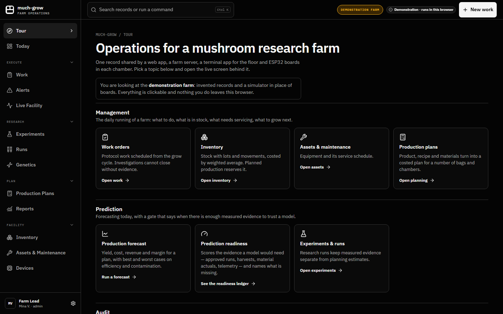
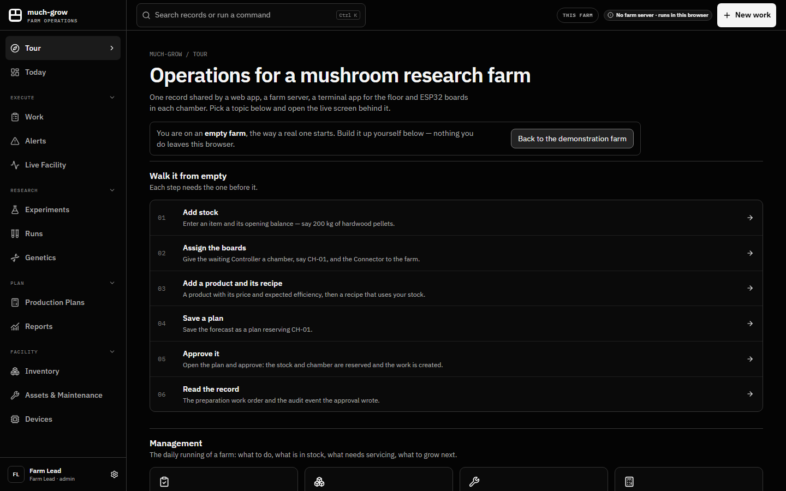
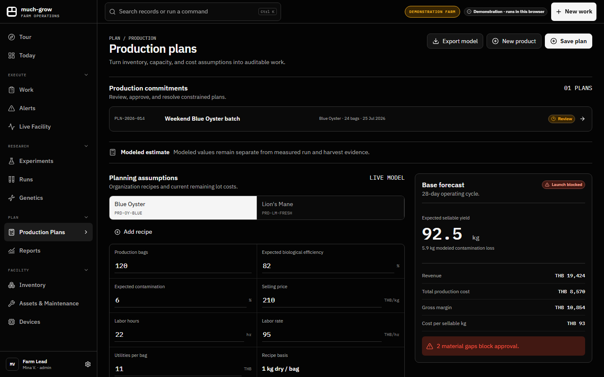
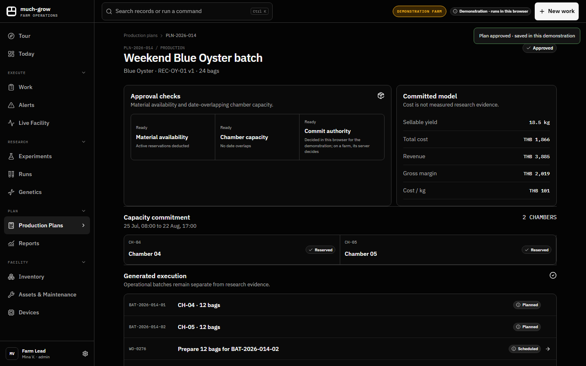
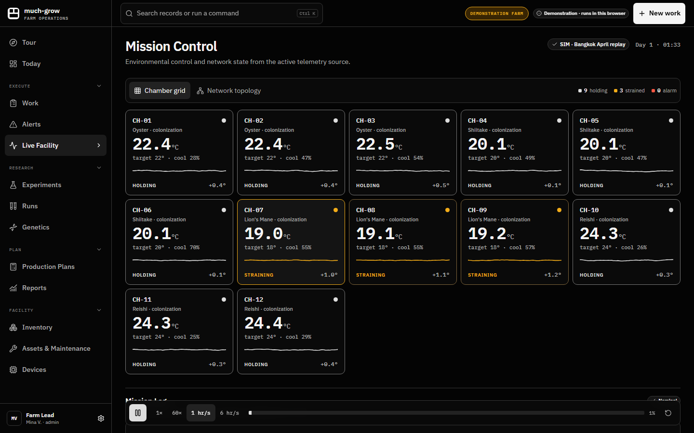
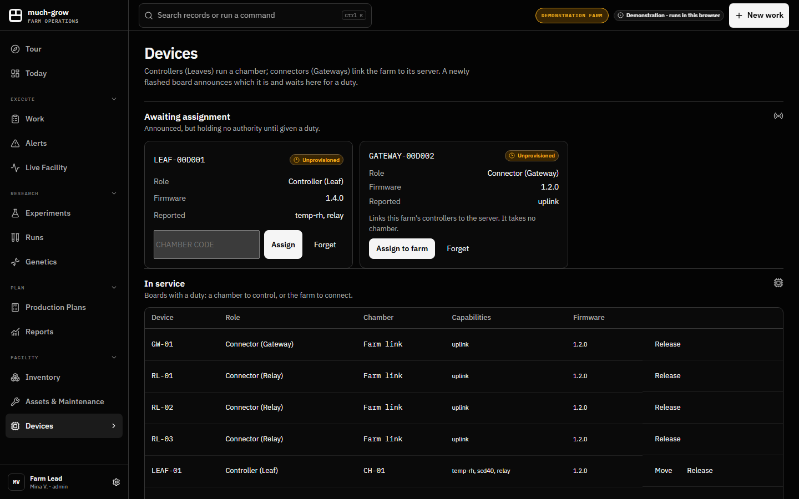
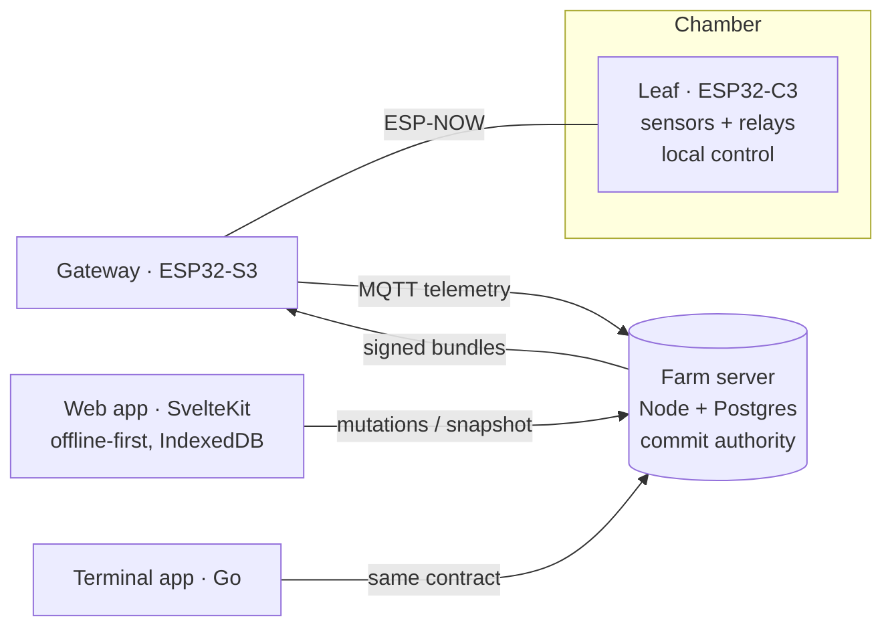

# Much-Grow

**Operations software for a mushroom research farm**: work, stock, equipment, production planning and live chamber control. One record is shared by a web app, a farm server, a terminal app for the floor and ESP32 boards in every chamber.

**[Open the live demo →](https://nonsfix.github.io/much-grow/)**

The demo runs a demonstration farm with invented records, and a simulator stands in for the boards. Everything is clickable, and nothing leaves your browser. Start at the tour, which links each topic below to its live screen.

### Or start from an empty farm

The tour's **Start from an empty farm** button switches to an empty farm, the way a real one starts, with a numbered walk through it: add stock, assign a waiting board to a chamber, add a product and recipe, save a plan, approve it, then read the work order and audit event it created. Every step works in your browser, and the demo farm is one click back.

## What it does

### Management
- **Work orders**: protocol work scheduled from the grow cycle. An investigation can't be closed without evidence.
- **Inventory**: stock with lots and movements, costed by weighted average. Planned production reserves it.
- **Assets and maintenance**: equipment and its service schedule.
- **Production plans**: product → recipe → materials → a costed plan for a number of bags and chambers.

### Prediction
- **Production forecast**: yield, cost, revenue and margin for a plan, with best and worst cases on biological efficiency and contamination.
- **Prediction readiness**: before any model is trusted, a ledger scores the measured evidence one would need (approved runs, harvests, material actuals, chamber telemetry) and names what's missing. Today the project forecasts, and this gate decides when a learned model has earned a place.

### Audit
- **Approval with one commit authority**: approving a plan reserves materials and chamber time, creates batches and work orders and writes an audit event, all or nothing. Only the farm server decides. A stale client can't approve twice, and a plan short of stock is refused whole. In the demo, the browser runs the same decision code.
- **Audit stream**: an append-only record of operational changes and who made them.

### IoT and control
- **Live facility**: chambers with temperature, humidity and CO₂, and the approved settings each one runs.
- **Devices**: a newly flashed board announces itself as a **Controller (Leaf)**, which runs a chamber, or a **Connector (Gateway)**, which links the farm to its server. It holds no authority until an operator assigns it.
- **Signed settings**: a chamber's approved targets reach its board as a signed, versioned Configuration Bundle. The board refuses replays and settings meant for another chamber.
- **Alerts to work**: a reading outside its approved band raises an alert, and one click turns it into corrective work.

## How it fits together

- **One contract, two languages.** The web app and the terminal app apply the same mutations. Golden test vectors run in both TypeScript and Go, so the two can't drift apart.
- **Offline-first web.** Writes land locally and queue for the server, and reconciliation brings the server's truth back. The high-risk decisions (approval, device assignment) are never queued: the server answers first.
- **Boards keep control locally.** A Leaf runs its chamber on its own approved settings if the server, internet or gateway goes away.
- **24 architecture decision records** document why it works this way.

## How it's tested

- **Unit and contract tests (Vitest):** reducer, reconciliation, repository, server handler, plus 20 golden vectors replayed in TypeScript and in Go.
- **End to end on an empty farm (Playwright):** walks every function the way a new operator would: enter stock, assets, strains, a product and recipe, plan and approve, then take a board from unplugged to assigned, controlled, alerting and forgotten. The board walk drives the **real bench bridge** against a virtual serial port.
- **Firmware host tests:** the logic each board runs (control loop, frames, enrollment, reports) compiled and checked on the build machine. Every hardware target is built in CI.

## Stack

SvelteKit · TypeScript · Node · Postgres · MQTT · Go (Bubble Tea) · ESP32 (Arduino / PlatformIO) · Playwright · Vitest

---

Built by [NONSFIX](https://github.com/NONSFIX). This repository holds the published demo build; the source is private.
